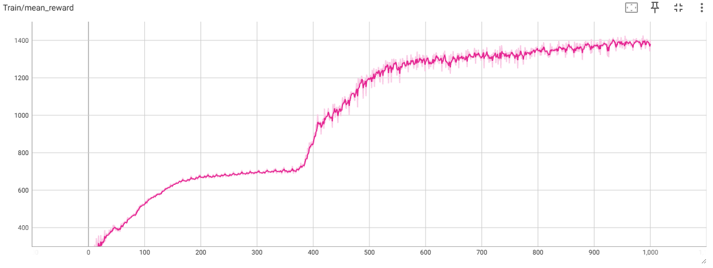
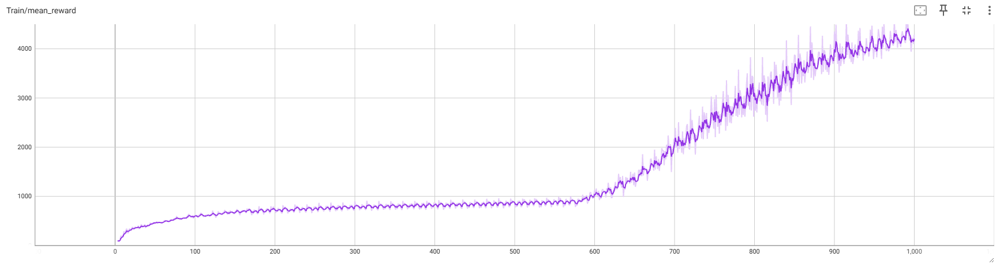
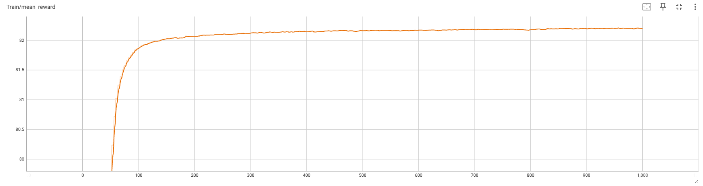
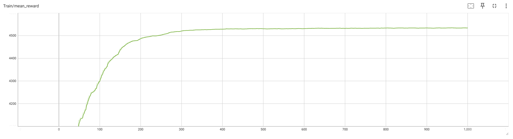
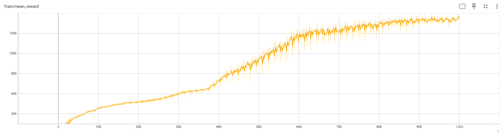

# Отчет о практике
Скорняков Денис, группа 9

## Параметры

| Параметр          | Файл / способ доступа                                              | Имя ключа / флага | Значение по умолчанию |
| ----------------- | ------------------------------------------------------------------ | ----------------- | --------------------- |
| num_envs          | `./train.ipynb` : `NUM_ENVS`                                       | `--num_envs`      | `4096`                |
| learning_rate     | `./train.ipynb` : `cfg_dict['algorithm']['learning_rate']`         |                   | `0.001`               |
| max_iters         | `./train.ipynb` : `MAX_ITERS`                                      | `--max_iters`     | `1001`                |
| gripper_box       | `./train.ipynb` : `env_cfg.reward_config.scales.gripper_box`       |                   | `4.0`                 |

## Изменения относительно baseline

| Эксперимент | Изменение в коде | Команда | `mean_reward` обучения | SR | Время | Поведение |
|---|---|---|---:|---:|---:|---|
| baseline | - | `python3 train.py --exp_name baseline` | 1400,96 | 10/10 | 1763 с | Приближается, захватывает куб и несёт к цели |
| scale | - | `python3 train.py --exp_name scale_2048 --num_envs 2048` | 1308,13 | 10/10 | 1316 с | Приближается, захватывает куб и несёт к цели |
| box_target_strong | `env_cfg.reward_config.scales.box_target = 40.0` | `python3 train.py --exp_name box_target_strong` | 4288,04 | 10/10 | 1749 с | Приближается, захватывает куб и несёт к цели |
| qpos_strong | `env_cfg.reward_config.scales.robot_target_qpos = 30.0` | `python3 train.py --exp_name qpos_strong` | 4533,85 | 0/10 | 1524 с | Остаётся на месте |
| gripper_box_zero | `env_cfg.reward_config.scales.gripper_box = 0.0` | `python3 train.py --exp_name gripper_box_zero` | 82,20 | 0/10 | 1641 с | Остаётся на месте |

**Гипотеза**: обнуление gripper_box затруднит освоение подхода к кубу и снизит SR относительно baseline.

**Результат**: финальный mean_reward обучения составил 82,20; на инференсе SR снизился с 10/10 до 0/10. Манипулятор оставался в начальной позе и не захватывал куб.

**Вывод**: гипотеза подтвердилась для проведённого запуска. Без награды за приближение агент, вероятно, не освоил касание куба и не получил достаточно сигнала для обучения переносу. Один запуск не доказывает, что такое поведение повторится при каждом обучении. Поскольку функция награды изменилась, абсолютные значения mean_reward нельзя напрямую использовать для сравнения качества политик.

## Графики обучения
### baseline

### box_target_strong

### gripper_box_zero

### qpos_strong

### scale_2048

# Яндекс
[Яндекс документ](https://disk.yandex.ru/i/R0bNs4q4plSGBg)